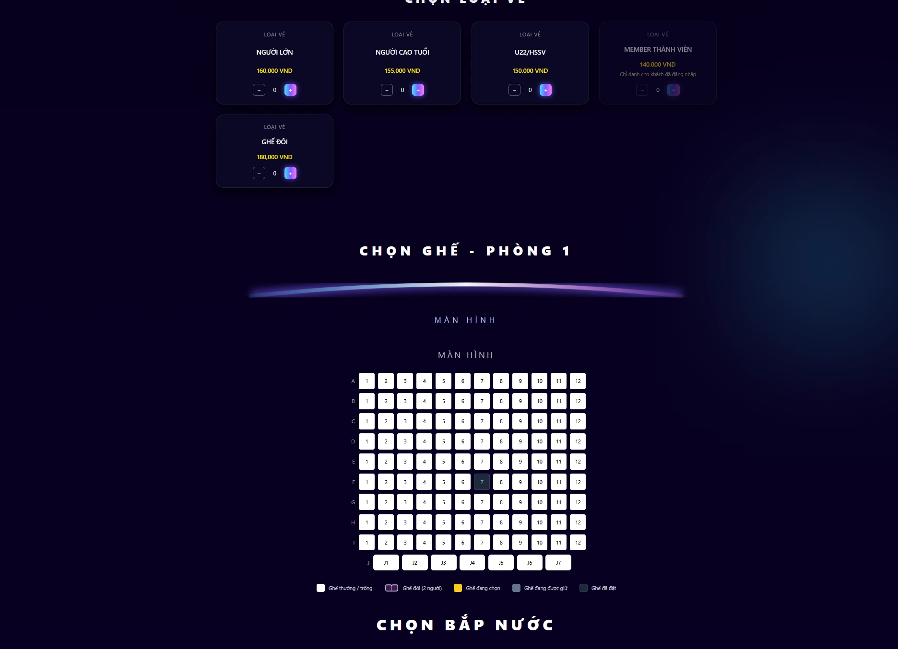

<h1 align="center">Pham Tran Quoc</h1>

<p align="center">
  Software Engineering Student · Full-stack Development &amp; Applied AI
</p>

<p align="center">
  Building practical software and exploring how Applied AI can help solve real-world problems.
</p>

<p align="center">
  
  
  
  
</p>

## [🌐 VIEW LIVE PORTFOLIO →](https://quoc-portfolio-roan.vercel.app/)

[https://quoc-portfolio-roan.vercel.app/](https://quoc-portfolio-roan.vercel.app/)

## About Me

I'm a final-year Software Engineering student at the University of Information Technology – VNU-HCM, with a GPA of 3.35/4.0. My background includes programming and building practical full-stack applications, including a movie booking platform with booking workflows and RESTful API integration. I'm interested in applying my problem-solving skills to useful software and exploring practical applications of AI. I continue to develop my technical foundation through hands-on projects and academic work, with a focus on growing as a software engineer and contributing to future Applied AI initiatives.

## Technical Skills

| Area                          | Skills                                                   |
| ----------------------------- | -------------------------------------------------------- |
| **Programming Languages**     | Python · JavaScript · PHP · TypeScript                   |
| **Frameworks & Technologies** | ReactJS · Next.js · Laravel · Tailwind CSS · MySQL       |
| **Core Knowledge**            | OOP · Data Structures & Algorithms · RESTful API         |
| **AI & Development Tools**    | Claude · GitHub Copilot · Codex · Git · GitHub · Postman |

## Featured Project

### Movie Booking Web (Cineon)

**Role:** Full-stack Developer<br>
**Tech stack:** ReactJS, JavaScript, Tailwind CSS, PHP Laravel, MySQL, RESTful API

A full-stack movie booking platform with customer-facing and administrative dashboards. My contributions include movie and showtime management, interactive seat selection with temporary seat locking, booking and payment workflows, and RESTful API integration between the ReactJS frontend and Laravel backend.

- **Live Demo:** [cineon-cinema.vercel.app](https://cineon-cinema.vercel.app/)
- **Frontend Repository:** [github.com/Quoosc/movie-booking-frontend](https://github.com/Quoosc/movie-booking-frontend)
- **Backend Repository:** [github.com/Quoosc/movie-booking-backend](https://github.com/Quoosc/movie-booking-backend)

## Education

**University of Information Technology – VNU-HCM**<br>
Bachelor's Degree in Software Engineering (Expected) · 2023–2027<br>
GPA: **3.35/4.0**

## Contact & Resume

- **Email:** [phamquoc896@gmail.com](mailto:phamquoc896@gmail.com)
- **GitHub:** [github.com/Quoosc](https://github.com/Quoosc)
- **Portfolio:** [quoc-portfolio-roan.vercel.app](https://quoc-portfolio-roan.vercel.app/)
- **Resume:** [View or download PDF](https://quoc-portfolio-roan.vercel.app/pham-tran-quoc-cv.pdf)
- **Location:** Ho Chi Minh City, Vietnam

## Product Preview

[](https://quoc-portfolio-roan.vercel.app/projects/cineon)

[Explore the Cineon case study](https://quoc-portfolio-roan.vercel.app/projects/cineon).
The portfolio includes a customer-to-admin product tour, a keyboard-accessible screenshot viewer, circular dark/light theme transitions, and responsive navigation.

## Local Development

```sh
npm ci
npm run dev
```

Open http://localhost:3000. Validate changes with:

```sh
npm run lint
npm run typecheck
npm run build
npm run start
```

## Content and Assets

- Personal information, portfolio domain, and resume URL: `lib/site-config.ts`.
- Cineon copy, links, and screenshot order: `data/projects.ts`.
- Skills and theme-aware colors: `data/skills.ts` and `data/technology-colors.ts`.
- Original PNGs, optimized WebP images, and thumbnails: `public/cineon/screenshots/`.
- Resume: `public/pham-tran-quoc-cv.pdf`.

For a new screenshot, add `src`, `thumbnail`, `alt`, and `caption` to the project data. Use descriptive English captions and public-demo booking data.

Contact uses email links and a Copy Email button. No email service credentials are needed.
SEO includes per-page metadata, a Cineon social image, sitemap, robots, and Person structured data. Set `siteConfig.url` when changing the portfolio domain.

The case study links to a reviewed backend revision for the reservation flow: expiring per-seat Redis locks and transaction-backed reservation records. The default 10-minute hold is configurable; no measured performance or production concurrency guarantees are claimed.
